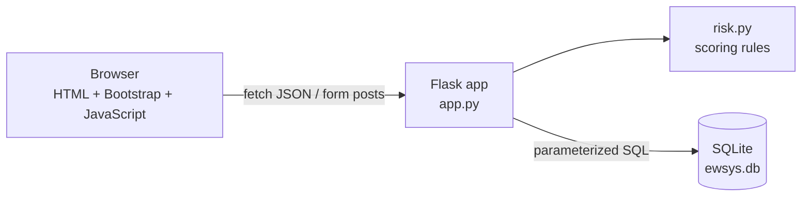
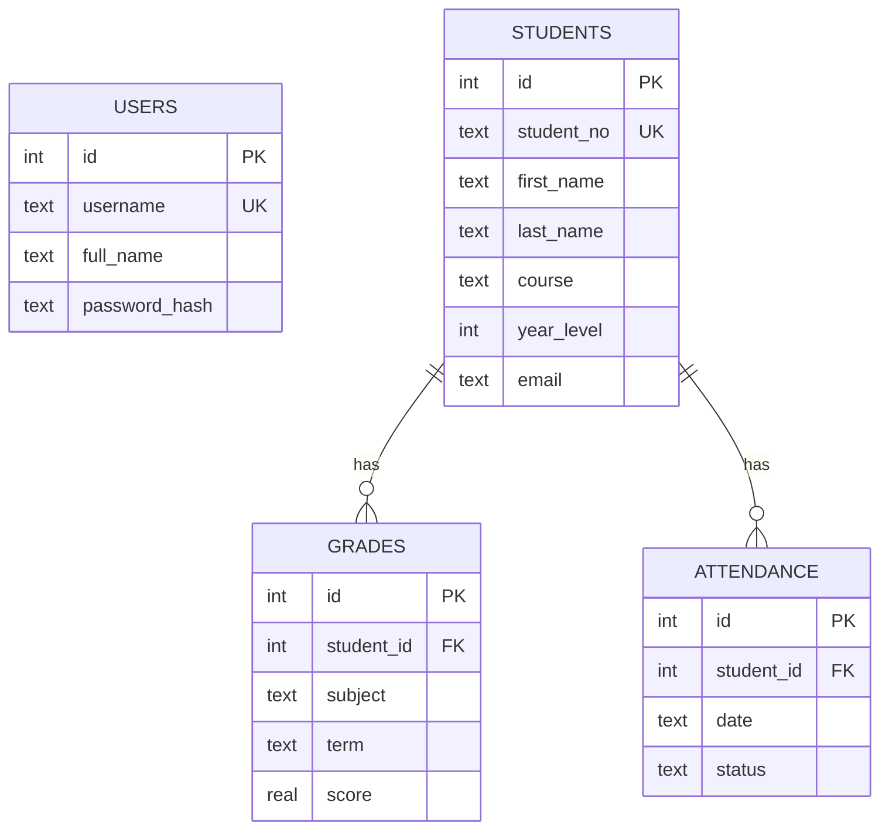

# 1. EduWatch: AI-Assisted Student Performance Monitoring and Early-Warning System

> BSIT Industry-Ready Portfolio · Project 1 (Web / Application Development)
> Datamex College of Saint Adeline, Parañaque City

**Live demo:** _add your deployed link here_  
**Source code:** _add this repository's link here_

---

## 2. Project Overview

EduWatch is a web application where teachers record students' grades and attendance and get an early warning when a student is falling behind. Each student receives a risk score from 0 to 100 and a plain-language explanation of *why*, with suggested next steps. The dashboard lists the students who most need attention first.

The "AI-assisted" part is a **transparent, rule-based scoring model** (see `risk.py`). It is not a machine-learning model and it does not call any external AI service. Every point of risk can be traced to a rule, so a teacher can check the result instead of trusting a black box.

## 3. Problem Statement

Teachers often notice a struggling student only after the grading period ends, when it is hard to help. Grades live in one place, attendance in another, and nobody combines them. A student who is passing but missing classes and slipping in recent quizzes can go unnoticed until it is too late.

## 4. Objectives

1. Store student records, grades and attendance in one database.
2. Provide secure teacher accounts so only authorized users can see student data.
3. Calculate an explainable risk score from grades, attendance and grade trend.
4. Show teachers who needs help first, and what to do about it.
5. Demonstrate full-stack skills: UI, database, CRUD, validation, search, authentication and error handling.

## 5. Target Users

- **Teachers / subject instructors** who record grades and attendance.
- **Class advisers and guidance staff** who follow up with at-risk students.

## 6. Technologies Used

| Layer | Technology |
|---|---|
| Frontend | HTML5, CSS3, JavaScript (ES6), Bootstrap 5, Bootstrap Icons |
| Backend | Python 3, Flask |
| Database | SQLite (via Python's built-in `sqlite3`) |
| Security | Werkzeug password hashing, Flask sessions, CSRF tokens, parameterized SQL |
| Testing | Python `unittest` and Flask's test client |
| Tools | Git, GitHub, VS Code |

## 7. System Features

| Requirement | How it is met |
|---|---|
| **User interface** | Responsive Bootstrap pages: login, register, dashboard, student detail |
| **Database** | SQLite with four related tables, foreign keys and constraints |
| **CRUD operations** | Create, read, update and delete students; add, edit and delete grades; record and delete attendance |
| **Validation** | Server-side checks on every field (the browser also shows field-level messages) |
| **Search** | Search by name, student number or course, plus a risk-level filter |
| **Authentication** | Register, log in and log out; every page and API route except login/register needs a session |
| **Error handling** | JSON errors with proper status codes (400, 401, 404, 409), friendly error pages, and a global handler for unexpected errors |

Also included: an early-warning risk score with explanations, summary cards, and demo data.

**How the risk score works** (`risk.py`)

| Part | Maximum | Rule |
|---|---|---|
| Grades | 60 | 0 risk at an average of 85 or higher, full risk at 60 or lower |
| Attendance | 30 | 0 risk at 95% or higher, full risk at 70% or lower (Present and Excused count 1, Late counts 0.5, Absent counts 0) |
| Trend | 10 | Extra risk when the latest two grades are lower than the earlier ones |

A total of 60 or more is **High**, 30 to 59 is **Moderate**, and below 30 is **Low**.

## 8. System Architecture



- **Browser:** server-rendered pages for layout and login; JavaScript calls the JSON API for the data screens.
- **Flask (`app.py`):** routes, authentication, validation, error handling.
- **`risk.py`:** pure functions with no database access, which makes them easy to test.
- **SQLite:** one file, created automatically on first run.

```
student-early-warning/
├── app.py            Flask app: routes, auth, validation, API
├── risk.py           Early-warning scoring rules
├── schema.sql        Database tables
├── seed.py           Demo data loader
├── requirements.txt
├── templates/        HTML pages (Jinja2)
├── static/           CSS and JavaScript
├── tests/            Automated tests
└── docs/screenshots/ Screenshots for this README
```

## 9. Database Design



- Deleting a student deletes their grades and attendance (`ON DELETE CASCADE`).
- `students.student_no` is unique; `attendance` is unique per student per date.
- `CHECK` constraints keep scores between 0 and 100, terms to Prelim/Midterm/Finals, and so on.
- The full SQL is in [`schema.sql`](schema.sql).

## 10. Screenshots

Add your own screenshots to `docs/screenshots/` after running the app, then they will show here.

| Screen | File |
|---|---|
| Login | `docs/screenshots/login.png` |
| Dashboard | `docs/screenshots/dashboard.png` |
| Add student form | `docs/screenshots/add-student.png` |
| Student detail with risk explanation | `docs/screenshots/student-detail.png` |

```markdown

```

## 11. Installation

You need **Python 3.10 or newer** and **Git**.

```bash
# 1. Get the code
git clone https://github.com/YOUR-USERNAME/student-early-warning.git
cd student-early-warning

# 2. Create and activate a virtual environment
python -m venv .venv
.venv\Scripts\activate          # Windows
# source .venv/bin/activate     # macOS / Linux

# 3. Install the dependencies
pip install -r requirements.txt

# 4. (Optional) load demo data and a demo account
python seed.py

# 5. Start the app
python app.py
```

Open <http://127.0.0.1:5000>.

**Configuration (optional)**

| Environment variable | Purpose |
|---|---|
| `SECRET_KEY` | Signs login sessions. If not set, a random key is created in `.secret_key` (ignored by Git). **Set a strong value on any deployed site.** |
| `DATABASE` | Path to the SQLite file. Default: `ewsys.db` in the project folder. |
| `FLASK_DEBUG=1` | Developer mode with auto-reload. Never use on a public server. |

## 12. How to Use

1. **Log in.** With demo data: username `teacher`, password `Teacher123!`. Otherwise click *Create one* and register.
2. **Dashboard.** See the totals, search students, filter by risk level.
3. **Add student.** Click *Add student*, fill in the form and save.
4. **Open a student.** Click their name to add grades (subject, term, score) and attendance.
5. **Read the assessment.** The risk panel explains the result and suggests next steps. It updates as you add data.
6. **Edit or delete.** Use the pencil and trash buttons.

## 13. Testing

Run the automated tests from the project folder:

```bash
python -m unittest discover -s tests -v
```

**Latest result: 26 tests, all passing.**

| Area | What is tested |
|---|---|
| Risk model | No data, strong student, struggling student, attendance credit for late, falling-grade trend |
| Authentication | API and pages need login, bad password rejected, logout ends the session, missing CSRF token rejected, open redirect blocked, duplicate username, password stored as a hash |
| CRUD | Create, read, update, delete for students and grades; attendance create and delete |
| Validation | Bad student number, empty name, year out of range, bad email, score above 100, future date, invalid date |
| Search | By name, by course, by risk level, `%` treated as plain text |
| Security | SQL injection attempt returns nothing and harms nothing |
| Errors | Unknown page gives a friendly 404, missing record gives JSON 404, duplicate gives 409, non-JSON body gives 400 |
| Database | Deleting a student removes their grades |

**Manual test checklist** (record your own results here)

| # | Test | Expected | Result |
|---|---|---|---|
| 1 | Open `/dashboard` while logged out | Redirected to login | |
| 2 | Add a student with a duplicate student number | Message "already exists" | |
| 3 | Enter a score of 150 | Field error, nothing saved | |
| 4 | Search for part of a name | Only matching students shown | |
| 5 | Add low grades and absences to a student | Risk rises to High with reasons | |
| 6 | Resize the browser to phone width | Layout stays usable | |

**Bugs found and fixed:** _add your own, for example "Search treated `%` as a wildcard, fixed by escaping it"._

## 14. Limitations

- The risk score uses fixed rules and thresholds. It has not been validated against real student outcomes, so it supports a teacher's judgement and must not be used to make decisions alone.
- All teachers share one student list (no per-class or per-teacher permissions, and no admin role).
- No password reset, email verification or login rate limiting.
- SQLite suits a small school or a demo; a larger deployment would move to MySQL or PostgreSQL.
- Grades are entered per term, not imported from a spreadsheet.

## 15. Future Improvements

- Per-class access, an admin role and audit logs.
- CSV/Excel import and export, and printable reports.
- Charts of grade and attendance trends over time.
- Notifications to advisers when a student moves to High risk.
- Optionally compare the rule-based score with a trained model, using real, anonymized data.

## 16. Developer / Contributors

**Journey A. Lemorinas**  
Bachelor of Science in Information Technology, Datamex College of Saint Adeline  
Specialization: Cybersecurity
GitHub: _add link_ · LinkedIn: _add link_ · Email: _add email_

Built as Project 1 of the BSIT Industry-Ready Portfolio. The demo students are fictional.
